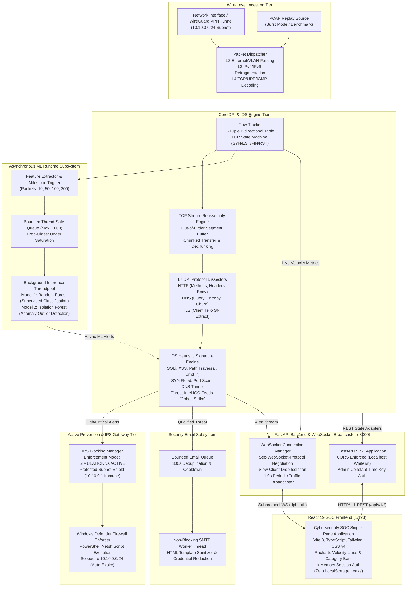
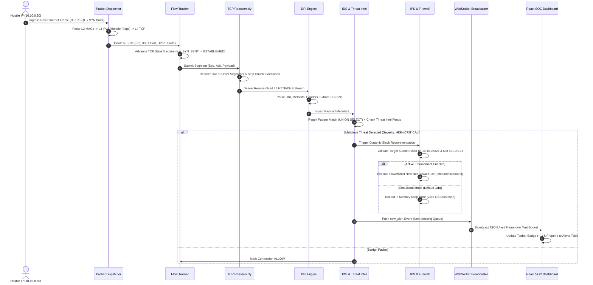
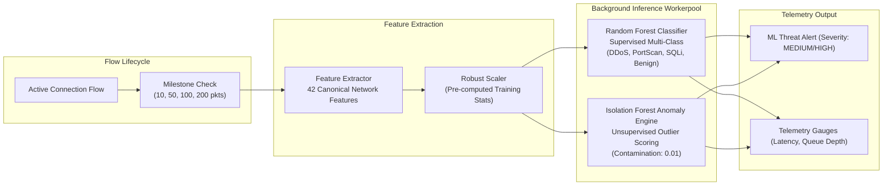
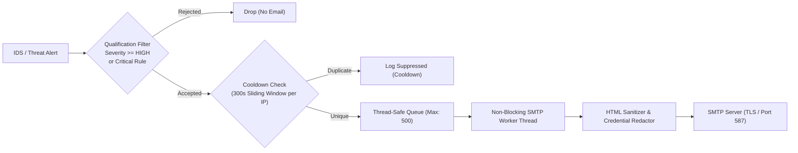
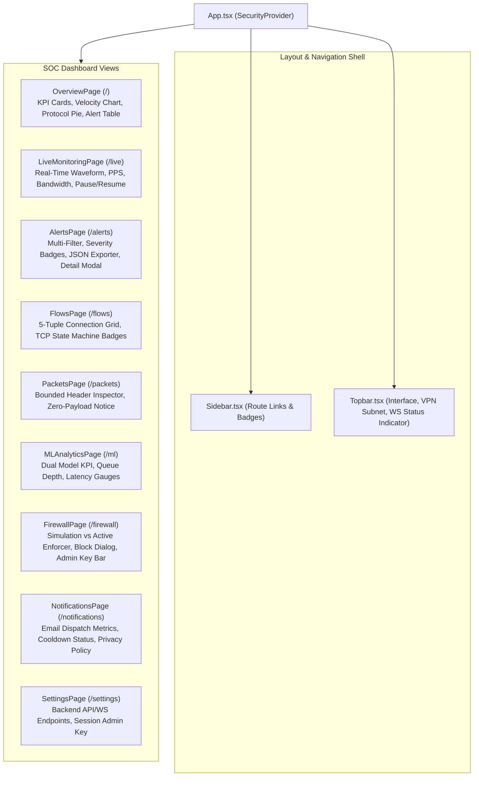

# Deep Packet Inspection (DPI) & Network IDS/IPS Platform — System Architecture, Endpoints & Technical Master Guide

> **Target Audience**: Software Engineering Interviews (System Design, Networking, Cybersecurity, Full-Stack Architecture, Distributed Telemetry).  
> **Repository**: DPI / IDS / IPS & React SOC Dashboard  
> **Key Technologies**: Python 3.12, FastAPI, Asyncio, Scapy, Npcap/WinPcap, Scikit-learn (Random Forest, Isolation Forest), Windows Defender Firewall (`netsh advfirewall`), React 19, TypeScript, Vite, Tailwind CSS v4, WebSockets, Recharts.

---

## Table of Contents

1. [Executive System Topology & Architecture Diagram](#1-executive-system-topology--architecture-diagram)
2. [End-to-End Packet Processing Lifecycle & Sequence Flow](#2-end-to-end-packet-processing-lifecycle--sequence-flow)
3. [Deep Packet Inspection (DPI) & TCP Reassembly Subsystem](#3-deep-packet-inspection-dpi--tcp-reassembly-subsystem)
4. [Intrusion Detection Engine (IDS) & Threat Intelligence Subsystem](#4-intrusion-detection-engine-ids--threat-intelligence-subsystem)
5. [Machine Learning Pipeline & Asynchronous Runtime Engine](#5-machine-learning-pipeline--asynchronous-runtime-engine)
6. [Intrusion Prevention System (IPS) & Windows Defender Firewall Enforcer](#6-intrusion-prevention-system-ips--windows-defender-firewall-enforcer)
7. [Comprehensive REST API Endpoint, Route & Service Mappings](#7-comprehensive-rest-api-endpoint-route--service-mappings)
8. [WebSocket Real-Time Monitoring & Event Streaming Subsystem](#8-websocket-real-time-monitoring--event-streaming-subsystem)
9. [Automated Email Security Notification Worker](#9-automated-email-security-notification-worker)
10. [Frontend Architecture, SOC Dashboard & UX Flow](#10-frontend-architecture-soc-dashboard--ux-flow)
11. [How to Start & Run the Entire Project Step-by-Step](#11-how-to-start--run-the-entire-project-step-by-step)
12. [System Design Interview Masterclass: 15 High-Frequency Q&As](#12-system-design-interview-masterclass-15-high-frequency-qas)
13. [Architecture Summary Cheat Sheet](#13-architecture-summary-cheat-sheet)

---

## 1. Executive System Topology & Architecture Diagram

The system is engineered as an **asynchronous, multithreaded network security platform** that strictly decouples **real-time high-throughput wire packet capture** from **heavy Layer-7 deep packet inspection, machine learning inference, and ASGI web streaming**.



### Architectural Highlights for Interviews
- **Blast Radius Isolation**: Heavy machine learning models (Random Forest with 100 estimators and Isolation Forest) execute in a dedicated asynchronous background threadpool. If the ML inference engine experiences latency or exceptions, the packet capture thread suffers **0% packet drops**.
- **Enforcement Truthfulness**: The system distinguishes between an **Alert Generated**, a **Simulated Drop**, and an **Active OS Firewall Block**. In laboratory and automated testing environments, it defaults to `SIMULATION` mode so operating system rules are never accidentally disrupted.
- **Credential Governance**: Administrative API keys and SMTP credentials are kept in memory and never persisted to browser `localStorage` or transmitted in WebSocket URL query strings.

---

## 2. End-to-End Packet Processing Lifecycle & Sequence Flow

When a network frame hits the capture interface or PCAP replay engine, it traverses a 7-stage pipeline:



---

## 3. Deep Packet Inspection (DPI) & TCP Reassembly Subsystem

The DPI engine reconstructs stream conversations and extracts Layer-7 application metadata across three primary protocols:

### A. TCP Stream Reassembly Engine (`dpi/tcp_reassembly.py`)
- **Out-of-Order Segment Buffer**: Segments arriving out of sequence are buffered in an ordered linked structure sorted by sequence number.
- **Duplicate & Retransmission Elimination**: Identifies and drops retransmitted byte ranges without corrupting the assembled stream.
- **HTTP Chunked Dechunking**: Decodes `Transfer-Encoding: chunked` streams, normalizes chunk size headers, handles chunk extensions, and stitches fragmented body segments.
- **Ambiguous Framing Mitigation**: Prevents HTTP Request Smuggling by detecting conflicting dual `Content-Length` headers or combined `Content-Length` and `Transfer-Encoding`.
- **Stream Inactivity Expiration**: Connections with inactive gaps purge buffers after a 30-second sliding timeout to bound host memory.

### B. HTTP Protocol Dissector (`dpi/http_inspection.py`)
- Decodes HTTP Request Methods (`GET`, `POST`, `PUT`, `DELETE`, `HEAD`, `OPTIONS`).
- Parses Request URIs, Query Parameters, Headers (`User-Agent`, `Host`, `Authorization`, `Cookie`).
- Safely extracts body payloads up to 64KB for inspection while discarding oversized media data.

### C. DNS Protocol Dissector (`dpi/dns_inspection.py`)
- Dissects DNS Queries and Responses over UDP and TCP port 53.
- Extracts Query Name (QNAME), Record Type (`A`, `AAAA`, `TXT`, `MX`, `CNAME`, `NS`), and Response Codes (`NOERROR`, `NXDOMAIN`, `SERVFAIL`).
- Computes Shannon entropy on fully qualified domain names (FQDN) to detect automated algorithmic domain generation.

### D. TLS Metadata Dissector (`dpi/tls_inspection.py`)
- Inspects TLS ClientHello handshakes without breaking end-to-end encryption.
- Extracts the Server Name Indication (SNI) extension, cipher suite offerings, and TLS version for domain reputation checks.

---

## 4. Intrusion Detection Engine (IDS) & Threat Intelligence Subsystem

The IDS engine operates as a hybrid detection framework combining signature heuristics, behavioral counters, and real-time threat intelligence reputation matching (`ids/`).

### A. HTTP Attack Detectors (`ids/http_threat_detectors.py`)
| Threat Category | Target Attack Signatures & Vectors | Severity | Evidence Captured |
| :--- | :--- | :--- | :--- |
| **SQL Injection (SQLi)** | `UNION SELECT`, boolean tautologies (`' OR '1'='1`), stacked queries (`; DROP TABLE`), hex encoded injections. | `HIGH` | Matched SQL token, raw query string, parameter name. |
| **Cross-Site Scripting (XSS)** | `<script>`, `javascript:`, DOM event triggers (`onload=`, `onerror=`), encoded alert functions. | `HIGH` | Script tag payload, attribute trigger. |
| **Path Traversal** | `../`, `..%2f`, `%2e%2e%2f`, Windows relative paths (`..\..\`), direct access to sensitive paths (`/etc/passwd`, `win.ini`). | `HIGH` | Traversal sequence, target system file path. |
| **Command Injection** | Command concatenation operators (`|`, `&&`, `;`, backticks, `$()`) coupled with shell binaries (`whoami`, `curl`, `bash`, `powershell`). | `CRITICAL` | Shell operator, target execution command. |

### B. Network Behavioral Detectors (`ids/ids_engine.py`)
- **TCP Port Scanning**: Detects horizontal scans (probes against 15+ distinct ports on an IP) and vertical scans (probes across multiple IPs on a single port) within a 5-second sliding window.
- **SYN Flood Detection**: Tracks half-open embryonic TCP connections; triggers critical alerts when SYN packets from an IP exceed safe thresholds (30 pkts/sec) without completing handshakes.
- **TTL Variance & Spoofing Detection**: Evaluates sudden Time-to-Live variance within an established flow, flagging asymmetric routing anomalies or IP spoofing attempts.

### C. Advanced DNS Detectors (`ids/dns_threat_detectors.py`)
- **DNS Tunneling & Exfiltration**: Calculates Shannon entropy over subdomains. Flags high-entropy pseudo-hex strings (>3.5 entropy score) exceeding 30 characters used for data exfiltration.
- **Domain Generation Algorithms (DGA)**: Detects algorithmically generated domains based on consonant-vowel ratios, numeric ratios, and dictionary wordlessness.
- **Fast Flux DNS**: Identifies rapid IP address churn where a single domain returns diverse IPv4/IPv6 address sets with short TTLs (<300s).

### D. Threat Intelligence IOC Engine (`ids/threat_intel.py`)
- Matches network IPs, CIDR ranges, and domains against curated Threat Intelligence feeds.
- Pre-seeded with known Command-and-Control (C2) indicators, such as Cobalt Strike beacon addresses (`198.51.100.23`).
- Supported by an in-memory Trie for IPv4/IPv6 CIDR lookup with sub-microsecond matching.

---

## 5. Machine Learning Pipeline & Asynchronous Runtime Engine

The platform incorporates a dual-model machine learning architecture (`ml/`) designed to catch both known classified attacks and zero-day behavioral anomalies.



### Canonical Feature Schema (42 Network Features)
Extracted incrementally from bidirectional flow state:
1. **Flow Duration & Inter-Arrival Times**: `flow_duration`, `fwd_iat_mean`, `bwd_iat_mean`, `fwd_iat_std`, `flow_iat_max`.
2. **Packet Length Distributions**: `fwd_pkt_len_mean`, `bwd_pkt_len_mean`, `fwd_pkt_len_std`, `pkt_len_variance`.
3. **Throughput Velocity**: `flow_pkts_per_sec`, `flow_bytes_per_sec`.
4. **TCP Flag Counts**: `syn_count`, `fin_count`, `rst_count`, `psh_count`, `ack_count`, `urg_count`.
5. **Session Directionality**: `fwd_header_len`, `bwd_header_len`, `down_up_ratio`.

### Asynchronous Runtime Engine (`ml/runtime/engine.py`)
- **Non-Blocking Queue**: Uses a thread-safe bounded queue (`maxsize=1000`). If traffic surges beyond capacity, the queue drops the oldest jobs to guarantee that packet ingestion never blocks.
- **Dual-Model Execution**:
  - **Random Forest**: Predicts specific attack categories with confidence probability scores.
  - **Isolation Forest**: Calculates decision function scores to isolate statistical outliers without relying on signatures.
- **Flow Milestone Re-evaluation**: Instead of classifying on every single packet, flows are re-evaluated at milestone packet counts (10, 50, 100, 200) as statistical distributions mature.

---

## 6. Intrusion Prevention System (IPS) & Windows Defender Firewall Enforcer

The mitigation engine (`ips/`) provides safe, reversible, and auditable network blocking.

### A. Safety Guarantees & Subnet Boundary
- **Hard Subnet Isolation**: The enforcer only permits blocking IP addresses within the designated VPN client subnet: `10.10.0.0/24`.
- **Infrastructure Immunity**: The server gateway IP (`10.10.0.1`), loopback addresses (`127.0.0.0/8`), broadcast addresses, multicast addresses, and WireGuard port `51820` are strictly protected by validation logic and can **never** be blocked.
- **Fail-Safe Privilege Detection**: If the application runs without Windows Administrator privileges, it automatically falls back to `SIMULATION` mode, logging simulated drops without attempting host OS changes.

### B. Windows Defender Firewall Integration (`ips/windows_firewall_enforcer.py`)
When running in active enforcement mode with administrative rights, the enforcer executes PowerShell commands using `-PolicyStore ActiveStore` to configure inbound and outbound packet rejection:

```powershell
# Inbound Drop Rule
New-NetFirewallRule -Name 'NIPS_BLOCK_10.10.0.50' -DisplayName 'NIPS_BLOCK_10.10.0.50' `
  -Direction Inbound -Action Block -RemoteAddress '10.10.0.50' `
  -PolicyStore ActiveStore -Description 'NIPS temporary inbound block' -Enabled True

# Outbound Drop Rule
New-NetFirewallRule -Name 'NIPS_BLOCK_10.10.0.50_OUT' -DisplayName 'NIPS_BLOCK_10.10.0.50_OUT' `
  -Direction Outbound -Action Block -RemoteAddress '10.10.0.50' `
  -PolicyStore ActiveStore -Description 'NIPS temporary outbound block' -Enabled True
```

### C. Temporary Rule Expiration & Reversibility
- Every block rule includes a `duration_seconds` parameter (default: 300s, max: 86400s).
- A background garbage-collection thread continuously evaluates `expires_at` timestamps and purges expired rules from Windows Firewall, preventing stale rule buildup.

---

## 7. Comprehensive REST API Endpoint, Route & Service Mappings

The FastAPI backend exposes versioned REST APIs under `/api/v1/`. All handlers are non-blocking, delegating business logic to singleton adapter services.

| HTTP Method | Route Path | Request Parameters / Headers | Controller / Service Operation | Response Schema | Description & Behavioral Guarantees |
| :--- | :--- | :--- | :--- | :--- | :--- |
| `GET` | `/api/v1/health` | None | `health_router` | `HealthResponse` | Evaluates operational readiness of DPI pipeline, ML runtime, and notification worker. |
| `GET` | `/api/v1/stats` | None | `statsApi.getStatistics` / `PipelineAdapter` | `StatisticsResponse` | Real-time aggregate packet counts, byte rates, active flows, and category/severity alert breakdown. |
| `GET` | `/api/v1/alerts` | `limit=50`, `offset=0`, `severity`, `category`, `source_ip` | `alertsApi.getAlerts` / `AlertService` | `AlertListResponse` | Paginated security alerts with multi-column filtering. Excludes sensitive raw payload data. |
| `GET` | `/api/v1/alerts/{id}` | Path: `alert_id: int` | `alertsApi.getAlertById` / `AlertService` | `AlertItem` | Returns single alert forensic details, matched detection signature, and extracted evidence string. |
| `GET` | `/api/v1/flows` | `limit=50`, `offset=0`, `protocol`, `source_ip`, `is_active` | `flowsApi.getFlows` / `FlowService` | `FlowListResponse` | Paginated active and historical IP 5-tuple flows, duration, byte counts, and TCP state machine state. |
| `GET` | `/api/v1/flows/{id}` | Path: `flow_id: int` | `flowsApi.getFlowById` / `FlowService` | `FlowItem` | Deep inspection of a specific connection session including cumulative byte counts and active flags. |
| `GET` | `/api/v1/packets` | `limit=50` (max: 100), `offset=0` | `packetsApi.getPackets` / `TrafficService` | `PacketListResponse` | Bounded packet header metadata. **Zero-Payload Policy**: Raw byte payloads are omitted for data privacy. |
| `GET` | `/api/v1/ml/status` | None | `mlApi.getStatus` / `MLService` | `MLStatusResponse` | Operational availability of Random Forest and Isolation Forest models, queue depth, and capacity. |
| `GET` | `/api/v1/ml/metrics` | None | `mlApi.getMetrics` / `MLService` | `MLMetricsResponse` | Quantitative ML performance telemetry: jobs processed, drops, inference latency, classification counts. |
| `GET` | `/api/v1/firewall/rules` | None | `firewallApi.getRules` / `FirewallService` | `FirewallRulesListResponse` | Returns list of configured IP drop rules, active duration, reason, and enforcement mode (`SIMULATION` vs `ACTIVE`). |
| `POST` | `/api/v1/firewall/block` | Headers: `X-API-Key`<br>Body: `{ ip_address, duration_seconds, reason }` | `firewallApi.blockIp` / `FirewallService` | `FirewallOperationResponse` | Dynamically blocks an IP. Requires admin authentication. Enforces subnet safety (`10.10.0.0/24`). |
| `DELETE` | `/api/v1/firewall/block/{id}`| Headers: `X-API-Key`<br>Path: `rule_id: str` | `firewallApi.unblockRule` / `FirewallService` | `FirewallOperationResponse` | Removes an active firewall block rule. Validates admin authorization before modifying rules. |
| `GET` | `/api/v1/notifications/status`| None | `notificationsApi.getStatus` / `NotificationManager` | `NotificationStatusResponse` | Metrics on emails delivered, queued, suppressed, and dropped. **Credentials and passwords are strictly excluded**. |

---

## 8. WebSocket Real-Time Monitoring & Event Streaming Subsystem

The WebSocket subsystem (`WS /ws/monitor`) streams live telemetry, traffic velocity, and alert feeds directly to connected SOC dashboards.

### A. Connection Lifecycle & Subprotocol Authentication
- **Secure Subprotocol Negotiation**: To prevent authentication tokens from being exposed in browser URL history or reverse-proxy logs, the frontend authenticates via the WebSocket subprotocol header:
  `new WebSocket("ws://127.0.0.1:8000/ws/monitor", ["dpi-auth", "<ADMIN_API_KEY>"])`.
- **Constant-Time Verification**: Tokens are compared using Python's `secrets.compare_digest()` to eliminate timing attack vectors.
- **Immediate State Synchronization**: Upon connection, the server pushes a `system_status` frame containing operational pipeline and model readiness flags.

### B. Real-Time Event Envelope Schema
All WebSocket messages adhere to a standardized schema:
```json
{
  "event": "traffic_update",
  "timestamp": "2026-11-11T07:55:00.000000+00:00",
  "data": {
    "packets_per_sec": 420.5,
    "bytes_per_sec": 384000.0,
    "total_packets": 128450,
    "total_bytes": 104857600,
    "active_flows": 24,
    "total_flows": 182,
    "active_workers": 4,
    "total_alerts": 18,
    "total_blocks": 2
  }
}
```

### C. Supported Real-Time Event Types
1. `traffic_update`: Broadcast periodically (cadence: 1.0s) with live PPS, bandwidth (bps), and active flows.
2. `new_alert`: Dispatched immediately when a signature or ML anomaly fires.
3. `new_flow`: Broadcast when an IP 5-tuple establishes a new TCP/UDP connection.
4. `ml_event`: Dispatched upon completion of high-confidence machine learning classifications.
5. `firewall_event`: Emitted when an IP is blocked or unblocked.
6. `notification_event`: Emitted when a security email is dispatched or suppressed.
7. `system_status`: Initial synchronization frame pushed to new connections.

### D. Concurrency & Slow-Client Protection
- **Decoupled Client Queues**: Every connected client holds an individual `asyncio.Queue(maxsize=100)`.
- **Slow-Client Drop Policy**: If a client's network freezes and its queue saturates, events for that specific client are dropped without blocking the central packet pipeline or other dashboard subscribers.

---

## 9. Automated Email Security Notification Worker

The email subsystem (`backend/services/notification/`) provides automated alert notifications while isolating the packet processing loop from SMTP latencies.



### Key Security & Reliability Controls
- **Duplicate Suppression**: Alerts for the same source IP and attack category are subject to a configurable cooldown (default: 300 seconds), preventing alert storms during DDoS or port scans.
- **Credential Redaction**: The template sanitizer inspects payload evidence and redacts common authorization tokens, passwords, and cookie strings before rendering HTML emails.
- **Non-Blocking Execution**: Email dispatches run on a dedicated worker thread. Even if an external SMTP server times out, packet capture continues uninterrupted.

---

## 10. Frontend Architecture, SOC Dashboard & UX Flow

The user interface is a dark-themed Security Operations Center (SOC) dashboard built with **React 19, Vite, TypeScript, and Tailwind CSS v4**.



### Frontend Optimization & Security Highlights
- **Vite Manual Chunking**: Third-party vendor dependencies are partitioned into distinct, cacheable browser chunks:
  - `vendor-recharts`: Recharts data visualization library.
  - `vendor-icons`: Lucide React icon set.
  - `vendor-router`: React Router DOM.
  - `index`: Application logic and components.
- **Bounded State Memory**: The incoming alert stream is deduplicated by `alert_id` and capped at 50 records in memory to prevent browser tab crashes during prolonged monitoring.
- **In-Memory Credential Handling**: The administrative API key is managed via React context (`SecurityContext.tsx`) and is **never written to localStorage or cookies**.

---

## 11. How to Start & Run the Entire Project Step-by-Step

### Prerequisites
1. **Operating System**: Windows 10/11 (or Linux)
2. **Python**: Python 3.12+ (64-bit) installed and on `PATH`
3. **Node.js**: Node.js 18+ or 20+ installed

---

### Method A: Automated One-Click Launch (Recommended for Windows)

From the root `dpi` folder, open PowerShell and run:
```powershell
.\start_soc_system.ps1
```
This script launches:
1. The FastAPI backend server on `http://127.0.0.1:8000`.
2. The React Vite development server on `http://127.0.0.1:5173`.

---

### Method B: Manual Step-by-Step Launch

#### Step 1: Set Up Python Backend
```powershell
# 1. Navigate to project root
cd D:\dpi

# 2. Create Python virtual environment
python -m venv .venv

# 3. Activate the virtual environment
.\.venv\Scripts\Activate.ps1

# 4. Install backend dependencies
pip install --upgrade pip
pip install -r project_networking/requirements.txt
```

#### Step 2: Set Up React Frontend
```powershell
# 1. Navigate to frontend directory
cd D:\dpi\frontend

# 2. Install Node dependencies
npm install
```

#### Step 3: Start the FastAPI Backend Server
Open **Terminal 1**:
```powershell
cd D:\dpi\project_networking
$env:PYTHONPATH="D:\dpi\project_networking"
..\.venv\Scripts\python -m uvicorn backend.api.main:create_app --factory --host 127.0.0.1 --port 8000
```
*Expected Output:*
```
INFO:     Started server process
INFO:     Application startup complete.
INFO:     Uvicorn running on http://127.0.0.1:8000 (Press CTRL+C to quit)
```

#### Step 4: Start the React Frontend Server
Open **Terminal 2**:
```powershell
cd D:\dpi\frontend
npm run dev
```
*Expected Output:*
```
  VITE v8.3.7  ready in 650 ms
  ➜  Local:   http://127.0.0.1:5173/
```

#### Step 5: Open the SOC Dashboard
Navigate to **`http://127.0.0.1:5173`** in your browser.  
The topbar status indicator will display **`WS CONNECTED`** in green.

---

### Step 6: Running the Automated Test Suites

#### Run Backend Test Suite (137 Tests)
```powershell
cd D:\dpi\project_networking
$env:PYTHONPATH="D:\dpi\project_networking"
..\.venv\Scripts\python -m pytest tests/
```

#### Run Frontend Unit & Integration Tests (Vitest)
```powershell
cd D:\dpi\frontend
npm test
```

#### Run Frontend Production Build
```powershell
cd D:\dpi\frontend
npm run build
```

---

## 12. System Design Interview Masterclass: 15 High-Frequency Q&As

### Q1: Why decouple packet capture from machine learning inference using an asynchronous queue?
**Answer:** Wire-speed packet capture operates under hard real-time constraints. If packets arrive at 50,000 packets per second, a thread blocking for 5 milliseconds to calculate a Random Forest tree traversal would cause the OS socket buffer to overflow, dropping hundreds of subsequent packets. By pushing extracted flow features into a thread-safe bounded queue (`Queue(maxsize=1000)`), the capture thread completes its work in microseconds. Background worker threads process ML inference asynchronously.

---

### Q2: How does the platform defend against HTTP Request Smuggling and ambiguous framing?
**Answer:** In `dpi/tcp_reassembly.py`, the HTTP stream dissector strictly evaluates RFC 7230 compliance:
1. If a message contains both `Transfer-Encoding: chunked` and `Content-Length`, the dissector flags the stream as ambiguous and prioritizes chunked encoding while raising an IDS alert.
2. If multiple conflicting `Content-Length` headers appear, the message is immediately flagged as a potential desynchronization attack.
3. Chunk size headers with invalid extensions or unexpected trailers are rejected.

---

### Q3: How do you prevent Denial of Service (DoS) attacks on the TCP reassembly buffer?
**Answer:** A malicious attacker can send out-of-order TCP segments with sequence gaps to force the server to buffer data indefinitely. We defend against this with three controls:
1. **Per-Flow Segment Limits**: Maximum out-of-order segment count per connection.
2. **Buffer Memory Ceilings**: Enforced maximum byte buffer per direction.
3. **Sliding Inactivity Timeout**: Gapped connections that do not complete reassembly within 30 seconds are pruned.

---

### Q4: Why use WebSocket subprotocol authentication instead of passing the token in the URL query string?
**Answer:** Passing tokens in query parameters (`ws://host/ws/monitor?token=SECRET`) creates security risks:
1. Query strings are recorded in plain text in reverse-proxy access logs (Nginx, Cloudflare), server logs, and browser navigation history.
2. Shoulder surfers can see credentials directly in the URL bar.
By passing the token via the `Sec-WebSocket-Protocol` header (`["dpi-auth", token]`), the token is negotiated within the HTTP upgrade request headers and leaves the URL clean (`ws://host/ws/monitor`).

---

### Q5: How does the system ensure Windows Defender Firewall commands cannot be exploited for command injection?
**Answer:** In `ips/windows_firewall_enforcer.py`:
1. The target IP string is parsed and validated using Python's `ipaddress.ip_address(ip)`. Any non-IP input (e.g. `10.10.0.5; calc.exe`) throws a `ValueError` and is rejected.
2. The IP address must belong to the approved subnet: `10.10.0.0/24`.
3. Commands are passed to `subprocess.Popen` as an explicit argument array (`["powershell", "-Command", ...]`) rather than through shell string evaluation (`shell=False`), preventing shell metacharacter injection.

---

### Q6: What prevents the firewall enforcer from accidentally locking out administrators or dropping system traffic?
**Answer:** The enforcer implements hardcoded immunity checks:
- The server VPN gateway (`10.10.0.1`) cannot be blocked.
- Loopback (`127.0.0.0/8`), multicast (`224.0.0.0/4`), and broadcast addresses are immune.
- WireGuard port `51820` cannot be blocked.
- Any request targeting an address outside `10.10.0.0/24` is rejected.

---

### Q7: Why use an Isolation Forest alongside a Random Forest classifier?
**Answer:** Random Forest is a **supervised** model trained on known attack signatures (DDoS, Port Scan, SQLi). It performs well on known patterns but struggles with zero-day attacks that do not match training distributions. Isolation Forest is an **unsupervised** anomaly detection model that isolates statistical outliers based on tree path depths, allowing the system to flag novel or unusual traffic patterns without requiring prior labels.

---

### Q8: What is "Session Correlation Leakage" in ML evaluation, and how does this project address it?
**Answer:** In network datasets like CICIDS2017, multiple flow records belong to the same multi-hour conversation between two hosts. These flows share identical TCP window sizes, TTL values, and packet timing distributions. If data is split randomly by row (`train_test_split(shuffle=True)`), flows from the same conversation end up in both the training and test sets, artificially inflating accuracy scores (>99%). As documented in Phase 9.2, production validation requires **GroupKFold** or **TimeSeriesSplit** partitioned by host IP or capture day.

---

### Q9: How does the WebSocket manager isolate slow dashboard clients from impacting server throughput?
**Answer:** Every connected client has an independent `asyncio.Queue(maxsize=100)`. When the broadcaster sends an event, it uses non-blocking `put_nowait()`. If a client's network buffer fills up, the server increments `messages_dropped` for that specific client and drops the event rather than blocking the dispatcher loop or other connected clients.

---

### Q10: How does the system handle duplicate security alert emails during an ongoing flood attack?
**Answer:** In `backend/services/notification/notification_manager.py`, an alert cooldown map tracks combinations of `source_ip` and `category`. If an alert matching an active entry arrives within the 300-second window, the system records it as suppressed without submitting an email job, protecting SMTP quotas and administrator inboxes.

---

### Q11: How does the system protect sensitive data in packet inspector views?
**Answer:** The `/api/v1/packets` endpoint implements a **Zero-Payload Policy**. It returns only Layer-2, Layer-3, and Layer-4 header metadata (IPs, ports, flags, packet size, detected L7 protocol). Raw packet payload hex/ASCII bytes are omitted to prevent the exfiltration of credentials or sensitive user data.

---

### Q12: Why use `secrets.compare_digest` instead of `==` for administrative API key validation?
**Answer:** Standard string comparison operators (`==` or `!=`) evaluate characters sequentially and terminate on the first mismatched byte. An attacker measuring round-trip network response times with microsecond precision can infer how many leading characters match. `secrets.compare_digest()` performs a constant-time comparison that takes the same amount of time regardless of match position, mitigating timing attacks.

---

### Q13: How does the React frontend optimize rendering under high-frequency WebSocket event streams?
**Answer:**
1. **Decoupled Velocity Updates**: Velocity line charts update at a controlled 1.0-second interval rather than re-rendering on every raw packet.
2. **Keyed Set Bounding**: Incoming alerts are deduplicated via a `Set<number>` tracking `alert_id` and capped at 50 records in memory.
3. **Component Code-Splitting**: Recharts, Lucide icons, and React Router are split into separate Rollup chunks (`vendor-recharts`, `vendor-icons`), ensuring initial bundle loads complete in ~1 second.

---

### Q14: How does the DNS dissector distinguish legitimate CDNs from malicious DNS Tunneling?
**Answer:** Both DNS tunneling and CDNs (e.g. Akamai, Cloudflare) use long subdomains. The detector differentiates them using two techniques:
1. **Second-Level Domain (eSLD) Allowlisting**: Queries to recognized CDN parent domains use higher churn thresholds.
2. **Entropy Scoring**: Base64/Hex exfiltration payloads produce high Shannon entropy (>3.5), whereas CDN subdomains follow structured patterns (e.g. `a123.g.akamai.net`) with lower character randomness.

---

### Q15: What happens if the backend server restarts while dashboard clients are connected?
**Answer:** The frontend's `WebSocketManager` maintains an automatic reconnection loop with exponential backoff and random jitter (2s initial, up to 30s max). When the backend comes back online:
1. The dashboard reconnects automatically without requiring a browser refresh.
2. The backend sends a fresh `system_status` frame to re-synchronize state.
3. The topbar status indicator transitions from `WS OFFLINE` to `WS CONNECTED`.

---

## 13. Architecture Summary Cheat Sheet

| Subsystem | Core Implementation File | Primary Responsibilities | Key Performance / Safety Metrics |
| :--- | :--- | :--- | :--- |
| **Ingestion & Dispatcher** | `parser/packet_dispatcher.py` | L2-L4 decoding, fragment reassembly, protocol routing | Zero-copy packet slicing, non-blocking |
| **Flow Tracker** | `models/flow_model.py` | 5-tuple bidirectional session table & TCP state tracking | Sub-microsecond hash lookup, 30s flow GC |
| **TCP Reassembly** | `dpi/tcp_reassembly.py` | Out-of-order segment stitching, dechunking, HTTP framing | Per-flow buffer limits, chunk smuggling defense |
| **DPI Engine** | `dpi/dpi_engine.py` | L7 payload inspection (HTTP, DNS, TLS SNI) | Payload limit (64KB), SNI extraction |
| **IDS Detection Engine** | `ids/ids_engine.py` | Heuristics (SQLi, XSS, CmdInj, SYN flood, port scans) | Regex optimization, IOC Trie lookup |
| **ML Runtime** | `ml/runtime/engine.py` | Dual-model inference (Random Forest + Isolation Forest) | Asynchronous threadpool, bounded queue (1000) |
| **IPS Firewall Enforcer** | `ips/windows_firewall_enforcer.py`| Windows Defender Firewall netsh rules, temporary bans | Scoped to `10.10.0.0/24`, simulation fallback |
| **Notification Worker** | `backend/services/notification/` | Email generation, SMTP dispatch, duplicate suppression | 300s alert cooldown, credential redaction |
| **FastAPI REST API** | `backend/api/main.py` | 13 endpoints: stats, alerts, flows, packets, ML, firewall | Localhost CORS whitelist, `compare_digest` auth |
| **WebSocket Broadcaster** | `backend/api/websocket/manager.py`| Real-time streaming (`WS /ws/monitor`) | Subprotocol negotiation, slow-client drop isolation |
| **SOC Dashboard** | `frontend/src/` | 9 views: Overview, Live, Alerts, Flows, ML, Firewall | React 19, code-split chunks, zero localStorage secrets |
